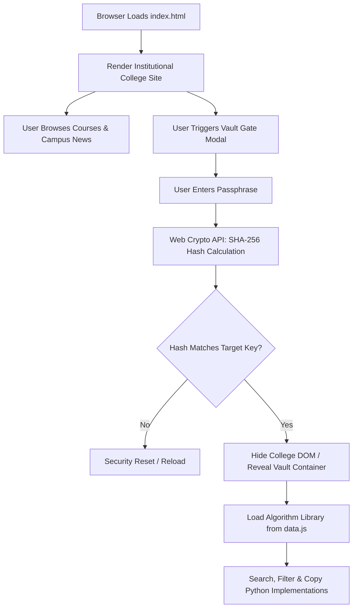

# Thakur Shyamnarayan Degree College — Web Portal & Interactive Practical Vault

[](index.html)
[](data.js)
[](Licence)

> A dual-layer static web portal for Thakur Shyamnarayan Degree College (Mumbai) featuring an institutional public landing page and a client-side cryptographic vault for exploring curated Machine Learning, Deep Learning, and Natural Language Processing practical implementations.

---

## 01 — Overview

**Thakur Shyamnarayan Degree College (TSDC) Web Portal** serves as both a front-facing institutional website mockup and an educational resource repository. It provides prospective students, faculty, and academic visitors with an overview of undergraduate programs (B.Sc. Information Technology, Computer Science, BMS, B.Com, and Arts), admissions notices, placement statistics, and campus events.

Beneath the institutional homepage lies an embedded **Student Practical Code Vault**. Designed for computer science and data science undergraduates, this vault organizes runnable Python implementations of core foundational algorithms—from McCulloch-Pitts neurons and backpropagation networks to TF-IDF vectorization and decision trees.

### What Makes This Project Interesting
- **Zero-Dependency Architecture:** Built completely with pure HTML5, CSS3, and modern vanilla JavaScript. No node build steps, bundlers, or heavy runtime frameworks required.
- **Client-Side SHA-256 Access Gate:** Demonstrates browser-native cryptography using the Web Crypto API (`crypto.subtle.digest('SHA-256', ...)`) to unlock the vault without requiring server infrastructure.
- **Searchable Algorithm Repository:** Features live client-side filtering, keyword highlighting, collapsible category folders, and 1-click clipboard integration with visual toast notifications.

---

## 02 — Demo & Interface Tour

The site is served statically and is split into two primary views:

### 1. Institutional Portal (`index.html`)
- **Emergency Ticker:** Live marquee announcing admissions, placement drives (TCS, Infosys, Wipro), and cultural events.
- **Academic Programs Showcase:** Grid presenting course duration, eligibility, and curriculum tracks.
- **Institutional Identity:** Brand navigation with official logo (`logo.jpg`) and hero banner (`banner.jpg`).

```text
┌────────────────────────────────────────────────────────────────────────┐
│ 📞 022-2846 1010  ✉️ info@tsdcmumbai.in            Portal | Alumni | NAAC│
├────────────────────────────────────────────────────────────────────────┤
│ 📢 Admissions Open for 2026-27 | NAAC 'A' Grade | Placements Drive 98% │
├────────────────────────────────────────────────────────────────────────┤
│ [Logo] Thakur Shyamnarayan Degree College                              │
│        Home   About   Programs   Admissions   Vault Gate [🔐]          │
└────────────────────────────────────────────────────────────────────────┘
```

### 2. Embedded Practical Code Vault
- **Deep Learning:** McCulloch-Pitts logic gates, Perceptron learning algorithm, Multi-layer Perceptron (MLP) with backpropagation for XOR.
- **Machine Learning:** Ordinary Least Squares Linear Regression, K-Nearest Neighbors (KNN), Decision Tree classifier.
- **Natural Language Processing:** Text normalization & tokenization, TF-IDF feature extraction.

---

## 03 — Features

### Verified & Implemented
- **Responsive Institutional Layout:** Mobile-first layout with smooth CSS grid transitions and flexbox navigation.
- **Web Crypto SHA-256 Gated Access:** Client-side hash verification protecting the educational vault view.
- **Instant Search & Query Highlighting:** Real-time filtering across practical titles and learning aims with `<span class="m-highlight">` matching.
- **One-Click Code Copy:** Native `navigator.clipboard` integration paired with animated toast confirmation.
- **Clean Fallback Typography:** Google Fonts (`Inter` / `Montserrat`) with native sans-serif fallbacks.

### Architectural Constraints & Non-Features
- **Frontend-Only Authentication:** The password verification executes in the browser against a SHA-256 digest (`cdb59ac4...`). Because the algorithm datasets reside in `data.js`, client-side gating is intended for educational demonstrations, not high-security confidentiality.

---

## 04 — Architecture & Workflow

The project operates entirely in the browser client lifecycle:



### Data Flow
1. **Initial Hydration:** `index.html` loads structure and styles (`style.css`), followed by synchronous loading of the algorithm database from `data.js`.
2. **State Transition:** Upon successful key validation, public DOM elements are cleanly unmounted (`display: none`) and the `#mRx` container activates with full focus handling.
3. **Interactive Search:** User keystrokes trigger debounced DOM filtering on the in-memory `subjects` array without page refreshes.

---

## 05 — Technology Stack

| Layer | Technology | Purpose |
| :--- | :--- | :--- |
| **Markup** | HTML5 Semantic Elements | Semantic, accessible structure (`<header>`, `<nav>`, `<article>`, `<dialog>`) |
| **Styling** | Vanilla CSS3 | Custom properties, responsive flex/grid layouts, keyframe animations |
| **Logic** | Vanilla JavaScript (ES6+) | DOM orchestration, clipboard events, and search indexer |
| **Security/Crypto** | W3C Web Crypto API | Native hardware-accelerated SHA-256 digest computation |
| **Data Storage** | JavaScript Object Literal (`data.js`) | Standalone, lightweight data dictionary of practical codebases |
| **Hosting** | Any Static File Host | Compatible with GitHub Pages, Cloudflare Pages, Vercel, Netlify |

---

## 06 — Installation & Setup

### Prerequisites
- Any modern web browser (Google Chrome, Firefox, Safari, Microsoft Edge).
- Optional: Python 3.x or Node.js to serve files locally.

### Local Development
1. **Clone the repository:**
   ```bash
   git clone https://github.com/your-username/static-college-site.git
   cd static-college-site
   ```

2. **Serve the project locally:**
   Using Python:
   ```bash
   python -m http.server 8000
   ```
   *Or using Node.js `npx`:*
   ```bash
   npx serve .
   ```

3. **Open in your browser:**
   ```text
   http://localhost:8000
   ```

---

## 07 — Usage Examples

### Unlocking the Practical Vault
1. Navigate to the footer or header trigger.
2. In the access modal prompt, enter the authorized passphrase.
3. Upon validation, the academic portal seamlessly switches to the algorithm explorer.

### Adding New Practicals
To expand the vault with additional subjects, append a new object to the `subjects` array in [`data.js`](./data.js):

```javascript
// Append to data.js:
subjects.push({
  name: "Computer Vision Practicals",
  practicals: [
    {
      title: "Practical 1: Sobel Edge Detection",
      aim: "To implement gradient-based horizontal and vertical edge detection.",
      code: `import cv2\nimport numpy as np\n# Implementation code...`
    }
  ]
});
```

---

## 08 — Testing & Verification

The project relies on clean standards-compliant browser capabilities and static code verification.

### Verification Summary
- **Syntax Validation:** Executed `node --check data.js` — **0 syntax errors**.
- **Static HTTP Asset Delivery:** Tested via local HTTP server:
  - `index.html` — `HTTP 200 OK`
  - `style.css` — `HTTP 200 OK`
  - `data.js` — `HTTP 200 OK`
  - `banner.jpg` — `HTTP 200 OK`
  - `logo.jpg` — `HTTP 200 OK`
- **Crypto API Support:** Verified compatibility with standard W3C SubtlesCrypto implementations.

---

## 09 — Project Structure

```text
Static-college-site/
├── index.html          # Main HTML structure, layout, and vault UI components
├── style.css           # Styling system, responsive layout, animations, theme tokens
├── data.js             # Data repository containing all algorithm practicals & source code
├── banner.jpg          # Campus hero banner photograph
├── logo.jpg            # College crest and institutional emblem
├── Licence             # MIT License terms
├── .gitignore          # Ignores OS metadata (DS_Store, Thumbs.db) and editor logs
└── README.md           # Authoritative project documentation
```

---

## 10 — License & Attribution

This project is licensed under the **MIT License**. See the [`Licence`](./Licence) file for the full legal text.

- **Author & Copyright:** (c) 2026 Ashmit Prasad founder of MAXL.
- **Attribution Note:** Institutional references, college names, and logos in this project are used for academic and demonstration purposes.
